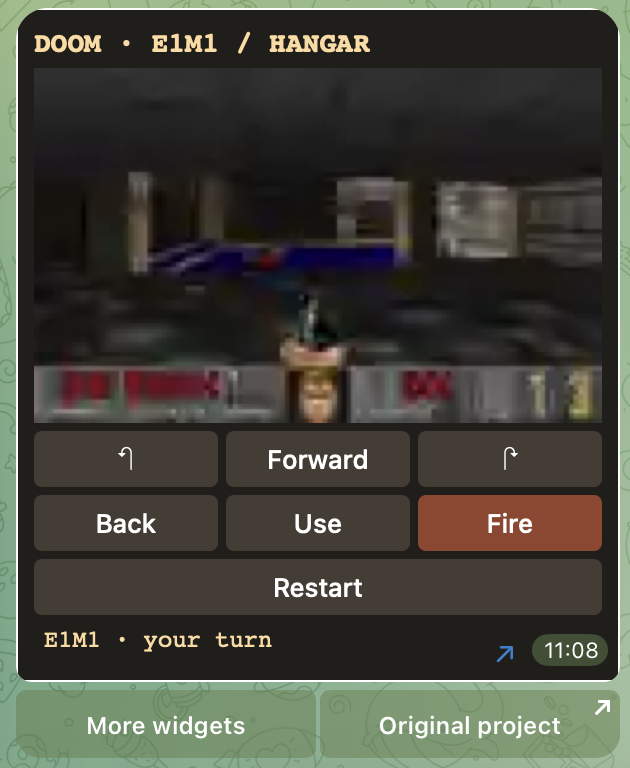

# Awesome Telegram Widgets

**English** · [Русский](README.ru.md)

Send `/start` for the English catalog or `/ru` for Russian.

Open [Doom in Telegram](https://t.me/awesomewidget_bot?start=doom) and tap **Start**. Use **More widgets** below the game to browse the collection. You can walk through the original Hangar, open doors and fire from the buttons underneath the frame. The engine runs on the bot’s host and returns a new frame after each move. Browse **Games** and **Tools**, or send a name or keyword in English or Russian. Results show up to six widgets per page.

A hand-picked collection of little apps built with Telegram’s HTML widget format. The game board, calculator or forecast lives inside a chat message. Each entry links to its creator’s project or widget file.

[Browse widgets](#widget-directory) · [Build a widget](#builders-workbench) · [Suggest a widget](https://github.com/ADanMan/awesome-telegram-widgets/issues/new?template=suggest-widget.md)

[Watch Doom in Telegram (13-second clip)](https://github.com/ADanMan/telegram-doom-widget/blob/main/screenshots/doom-telegram-en.mp4)

## Widget directory

| Widget | What you can do | Get it |
| :--- | :--- | :--- |
| **Pacman** | Steer through a maze, collect dots and dodge ghosts. The author includes a standalone build you can also play in a browser. | [Game and instructions](https://github.com/ronakserry/pacman) |
| **Calculator** | Tap through arithmetic on a compact keypad with a Persian interface. | [Widget HTML](https://github.com/Hamedshahi5/telegram-widgets/blob/main/calculator.html) |
| **Weather card** | Switch between sample forecasts to see how conditions change. Uses demo weather data. | [Widget HTML](https://github.com/VyacheslavTeplyakov/telegram-widget-lab/blob/main/examples/04-weather.html) |
| **Commute picker** | Compare three example routes inside a single message. Uses fictional trips. | [Widget HTML](https://github.com/VyacheslavTeplyakov/telegram-widget-lab/blob/main/examples/05-commute.html) |
| **Pocket inbox** | Page through sample emails. A companion bot serves the next page when you tap. | [Widget HTML](https://github.com/VyacheslavTeplyakov/telegram-widget-lab/blob/main/examples/07-mail-live.html) · [Demo bot setup](https://github.com/VyacheslavTeplyakov/telegram-widget-lab) |
| **Doom Message** | Play Doom’s E1M1 Hangar. Turn, walk, fire and open doors inside a message. The bot runs ViZDoom and streams each turn back to the message. | [Play in Telegram](https://t.me/ADanManDoomMessageBot?start=hangar) · [Source](https://github.com/ADanMan/telegram-doom-widget) |



**Trying a source example?** Open its project for setup instructions. To display widget HTML inside Telegram, a bot sends it with [sendWidget](https://core.telegram.org/bots/api#sendwidget). For a first test, use a private chat with your bot.

## Builder’s workbench

- [Telegram’s widget guide](https://core.telegram.org/bots/widgets) explains message size, tap handling and the data a bot can update.
- [Widget Sandbox](https://github.com/TelegramMessenger/widget-sandbox) is Telegram’s runtime and includes a guide to testing widgets at chat-bubble sizes.
- [TG Widget Kit](https://github.com/advanceddev/telegram-widget-kit) lets you edit HTML, CSS and JavaScript with a live bubble preview and compressed-size readout.
- [widgetgram](https://github.com/krendel001/widgetgram) adds widget sending and query handlers to Python bots built with aiogram 3.

## Add a find

[Suggest a widget](https://github.com/ADanMan/awesome-telegram-widgets/issues/new?template=suggest-widget.md) or open a pull request with one directory row. Include the creator’s public link, what a person can do inside the message, and how to try it. A public bot, playable demo or inspectable widget source all qualify. Mention any setup or sample data.

See the [contribution guidelines](CONTRIBUTING.md) for submissions, screenshots and bundling.

An independent community collection. Each linked project keeps its own license.

## Run AwesomeWidgetBot

[Open @awesomewidget_bot in Telegram](https://t.me/awesomewidget_bot). AwesomeWidgetBot is the English-language companion bot. Send `/start` in a private chat to open its menu. All six entries in the public bot run inside Telegram messages. The bot includes its own English implementations of Pacman (a turn-based maze), Calculator and Pocket inbox (three fictional messages you can page through).

On Telegram for macOS 13.2.0, the calculator returned 9 for 7 + 2, Pacman counted the first dot, and Pocket inbox advanced to the second message. The weather card switched to 18:00 and the commute picker selected the 16-minute route.

Create a bot with [BotFather](https://t.me/BotFather). Save its token in the owner-only file `~/.config/awesome-telegram-widgets/token` or set `TELEGRAM_BOT_TOKEN`. From the repository root run:

```sh
python3 bot/catalog.py
```

To host Doom inside your catalog bot, clone [Doom Message](https://github.com/ADanMan/telegram-doom-widget), install its requirements in the bot’s Python environment, set `DOOM_WIDGET_DIR` to that checkout and `DOOM_WAD` to your Doom Shareware 1.9 WAD. Without this optional backend, the Doom menu entry opens the dedicated game bot.

Keep one process running while serving the bot. The two bundled English demos adapt [Telegram Widget Lab](https://github.com/VyacheslavTeplyakov/telegram-widget-lab/tree/3c4fb0cd5cbb40d7e421dc217585b463859f4626) under its [MIT license](bot/widgets/LICENSE-widget-lab).
