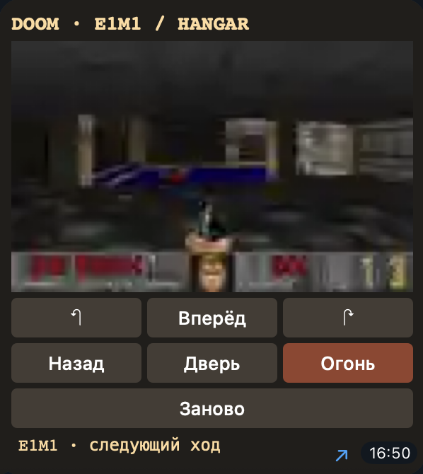

# Awesome Telegram Widgets

[English](README.md) · **Русский**

Каталог использует язык Telegram: русский или английский. Для других языков используется английский. Команды `/ru` и `/en` выбирают язык вручную, а `/start` возвращает автоматический выбор.

Откройте [Doom в Telegram](https://t.me/awesomewidget_bot?start=doom) и нажмите **Старт**. Кнопка **Ещё виджеты** под игрой открывает каталог. Перед вами ангар из первого Doom. Кнопками под кадром можно ходить, поворачивать, стрелять и открывать двери. Движок работает на стороне бота и после каждого хода возвращает новый кадр. В каталоге выберите **Игры** или **Инструменты** либо отправьте название или ключевое слово на русском или английском. На странице до шести результатов.



В каталоге собраны игры и инструменты на HTML-виджетах Telegram. Все шесть можно открыть в личном чате с ботом. В таблице указаны названия кнопок и ссылки на проекты авторов.

## Каталог

| Кнопка в боте | Что можно сделать | Проект |
| --- | --- | --- |
| **Doom Message** | Пройти E1M1 из Doom Shareware 1.9. Один ход продвигает игру на пять тиков. | [Исходники и скриншоты](https://github.com/ADanMan/telegram-doom-widget) · [Отдельный игровой бот](https://t.me/ADanManDoomMessageBot?start=hangar) |
| **Pacman** | Собирать точки в лабиринте и уворачиваться от привидения. В боте своя пошаговая версия. | [Проект автора](https://github.com/ronakserry/pacman) |
| **Calculator** | Выполнять арифметические операции на клавиатуре внутри сообщения. В оригинале интерфейс персидский, в боте русский и английский. | [Исходный виджет](https://github.com/Hamedshahi5/telegram-widgets/blob/main/calculator.html) |
| **Weather card** | Выбрать час и посмотреть температуру, ветер и вероятность осадков. Прогноз демонстрационный. | [Исходный виджет](https://github.com/VyacheslavTeplyakov/telegram-widget-lab/blob/main/examples/04-weather.html) |
| **Commute picker** | Сравнить время и расстояние для трёх вымышленных маршрутов. | [Исходный виджет](https://github.com/VyacheslavTeplyakov/telegram-widget-lab/blob/main/examples/05-commute.html) |
| **Pocket inbox** | Перелистать три вымышленных письма. В нашей версии письма хранятся внутри виджета. | [Исходный пример с серверной пагинацией](https://github.com/VyacheslavTeplyakov/telegram-widget-lab/blob/main/examples/07-mail-live.html) |

Проверено в Telegram для macOS 13.2.0. Калькулятор показал 9 для 7 + 2, Pacman засчитал первую точку, почта открыла второе письмо. Прогноз переключился на 18:00, маршрут — на 16 минут, Doom прислал новый кадр после поворота.

## Для разработчиков

- [Руководство Telegram](https://core.telegram.org/bots/widgets) описывает формат HTML, лимиты размера и обработку нажатий. Бот отправляет HTML в личный чат методом [sendWidget](https://core.telegram.org/bots/api#sendwidget).
- [Widget Sandbox](https://github.com/TelegramMessenger/widget-sandbox) позволяет тестировать виджет с размерами реального сообщения.
- [TG Widget Kit](https://github.com/advanceddev/telegram-widget-kit) объединяет редактор HTML, CSS и JavaScript, предпросмотр и счётчик размера после сжатия.
- [widgetgram](https://github.com/krendel001/widgetgram) добавляет отправку виджетов и обработку запросов в боты на aiogram 3.

## Запуск своего бота

Создайте бота в [BotFather](https://t.me/BotFather). Задайте переменную окружения `TELEGRAM_BOT_TOKEN` или сохраните токен в файле `~/.config/awesome-telegram-widgets/token` с правами доступа только для владельца. Запустите из корня репозитория:

```sh
python3 bot/catalog.py
```

Оставьте один процесс работающим. Для запуска Doom в своём каталоге скачайте [Doom Message](https://github.com/ADanMan/telegram-doom-widget), установите его Python-зависимости в то же окружение и задайте `DOOM_WIDGET_DIR` (путь к репозиторию) и `DOOM_WAD` (путь к файлу Doom Shareware 1.9). Без игрового движка кнопка ведёт в отдельный Doom-бот.

Погода и маршруты адаптированы из [Telegram Widget Lab](https://github.com/VyacheslavTeplyakov/telegram-widget-lab/tree/3c4fb0cd5cbb40d7e421dc217585b463859f4626) по [лицензии MIT](bot/widgets/LICENSE-widget-lab). У остальных проектов свои лицензии.

## Предложить виджет

[Откройте заявку](https://github.com/ADanMan/awesome-telegram-widgets/issues/new?template=suggest-widget.md) или пришлите pull request. Укажите автора, публичную ссылку и что можно попробовать прямо в сообщении. [Правила участия](CONTRIBUTING.ru.md)
